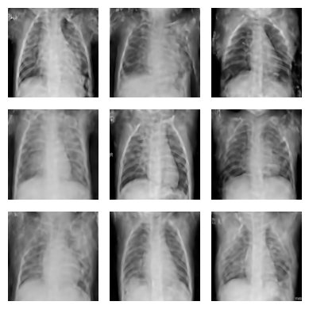
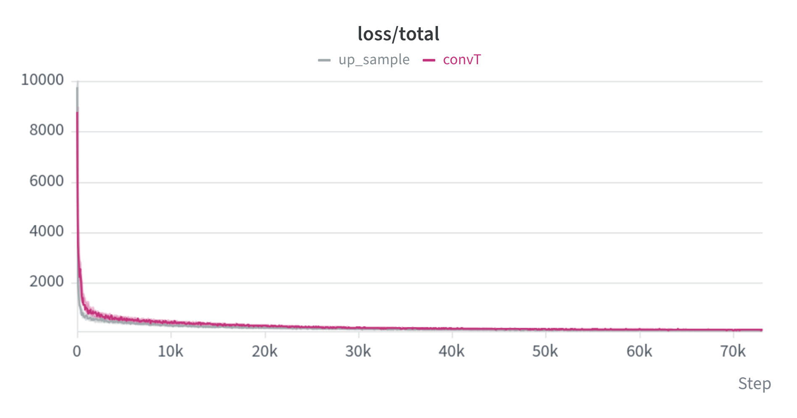
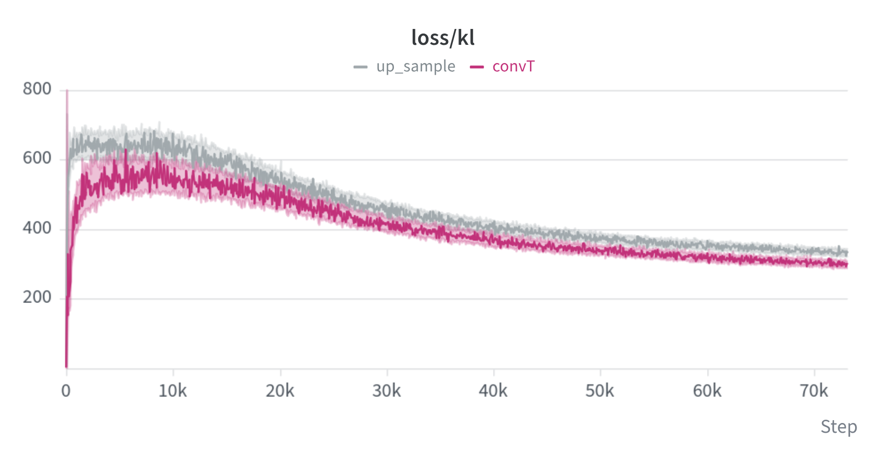
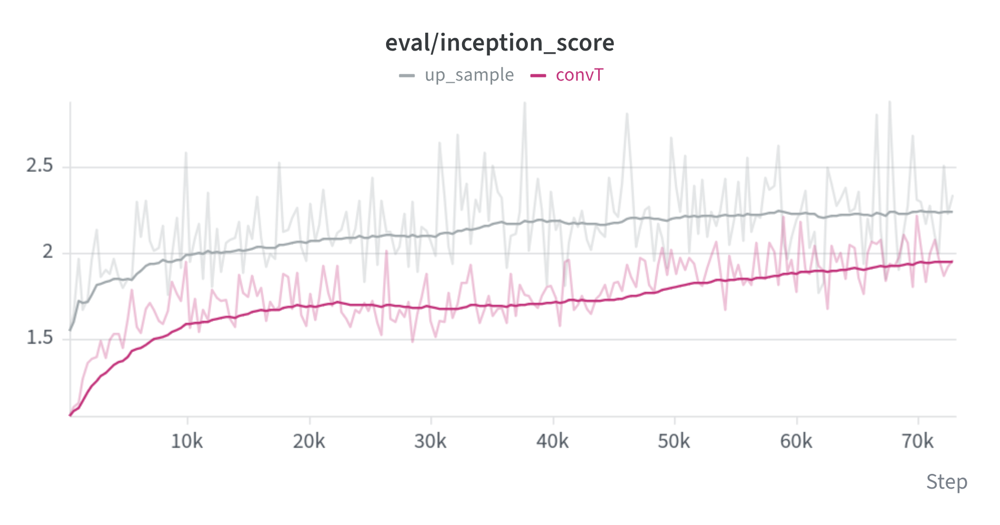
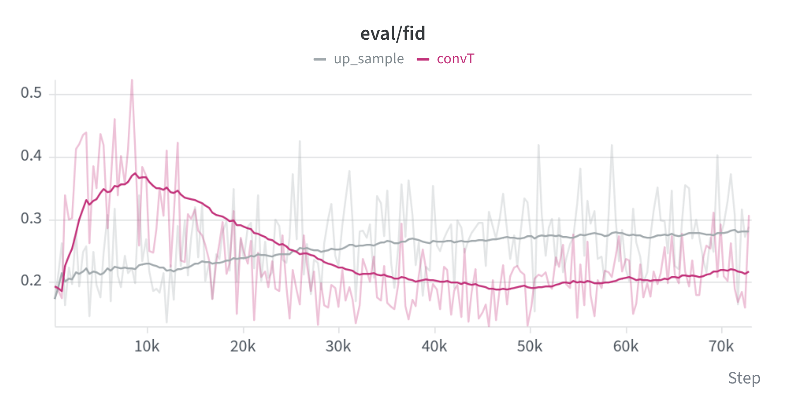

# VAE Image Generation

This project trains a Variational Autoencoder (VAE) on chest X-ray images to reconstruct and generate images from a learned latent space. The implementation is centered around the `VAE` class in [model/VAE.py](model/VAE.py), with encoder and decoder components in [model/encoder.py](model/encoder.py) and [model/decoder.py](model/decoder.py).

## Model Summary
The model takes an input image of shape `(B, 3, 224, 224)`, encodes it into a latent representation using a learned encoder, and predicts both:
- the latent mean `mu`
- the latent log-variance `log_var`

Using the reparameterization trick:

$$
z = \mu + \epsilon \cdot \exp(0.5 \log \sigma^2)
$$

the decoder reconstructs the image from the sampled latent vector. The training objective combines a reconstruction loss and KL regularization:

$$
\mathcal{L} = \lVert x - \hat{x} \rVert_2^2 + \beta \cdot D_{KL}(q(z|x) \,\|\, p(z))
$$

where the squared error is summed over pixels, both terms are averaged over the batch, and $\beta = 0.1$. This encourages the model to learn a compact latent space that can be used for generation and interpolation.

Two decoders were compared under otherwise identical settings:
- **up_sample**: each block uses nearest-neighbor upsampling followed by two 3x3 convolutions (the second one only mixes features and keeps the tensor shape).
- **convT**: each block uses a transposed convolution.

| Setting | Value |
|---|---|
| Input size | 3 x 224 x 224 |
| Latent dimension | 512 |
| Optimizer / learning rate | Adam / 1e-4 |
| Batch size | 32 |
| KL weight (beta) | 0.1 |
| Normalization / activation | GroupNorm(8) / SiLU |

## Generated Results

### Samples
Random samples decoded from `z ~ N(0, I)` with the upsampling decoder after 250 epochs:

  

### Metrics
Smoothed values at about 73k training steps (about epoch 200). IS and FID were computed with PyTorch-Ignite on only 32 generated and 32 real images per evaluation, so they are noisy and not comparable to published values.

| Decoder | Inception Score (higher is better) | FID (lower is better) | KL |
|---|---|---|---|
| up_sample | **2.24** | 0.28 | ~336 |
| convT | 1.95 | **0.21** | ~299 |

The upsampling decoder trains faster, reaches a higher Inception Score, and gives visually better samples. The extra mixing convolution in each upsampling block is believed to be the main reason (no ablation was run). convT reaches a lower but noisy FID.

### Training curves
Gray: up_sample, magenta: convT.

  
  

  
  

## Usage
To generate images from a trained model, run the notebook [generate_images.ipynb](generate_images.ipynb), or load a trained checkpoint into the model from [model/VAE.py](model/VAE.py) and call `vae.sample(num_samples)`. Training and evaluation are in [VAE_experiments.ipynb](VAE_experiments.ipynb).

## Notes
This is a lightweight image-generation VAE designed for learning a smooth latent space and producing sample reconstructions from random latent codes.