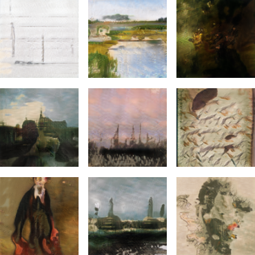
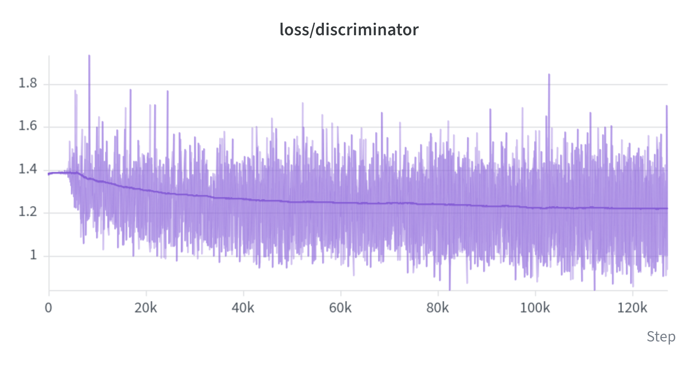
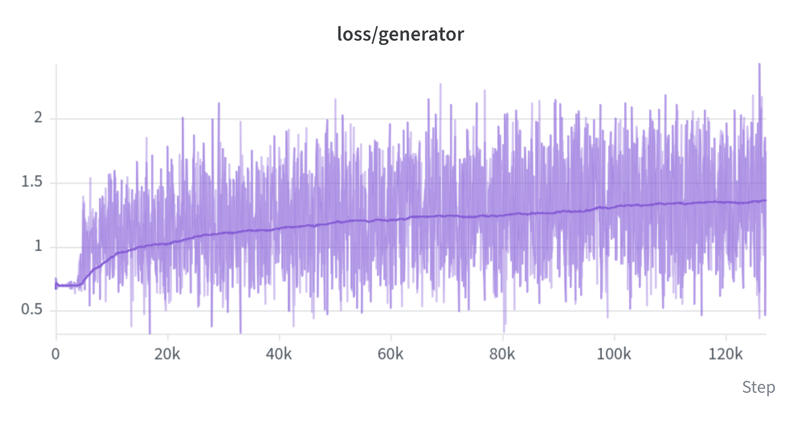
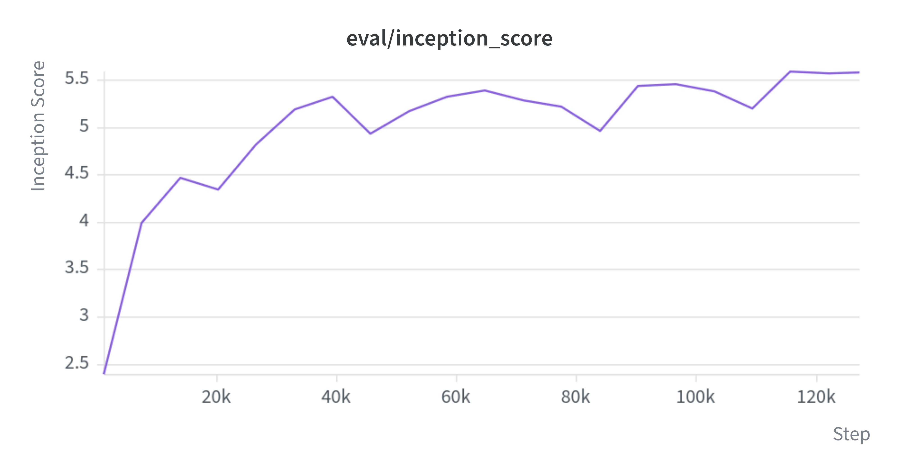
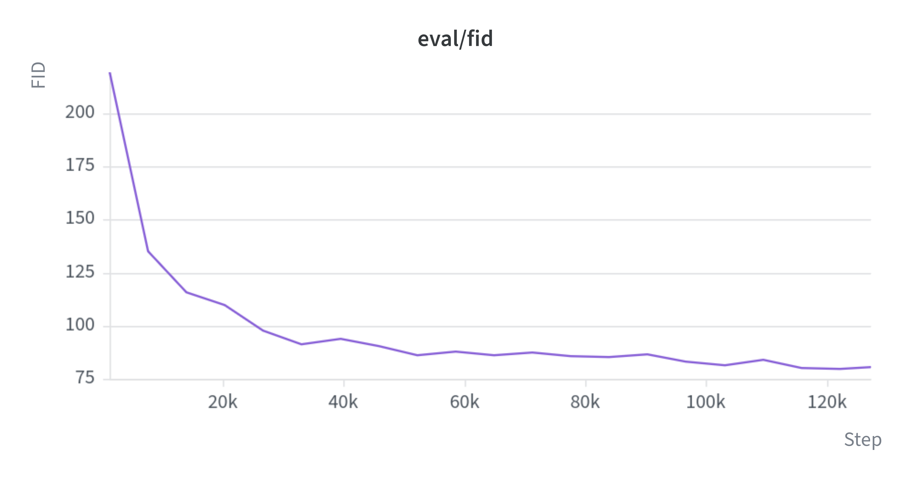
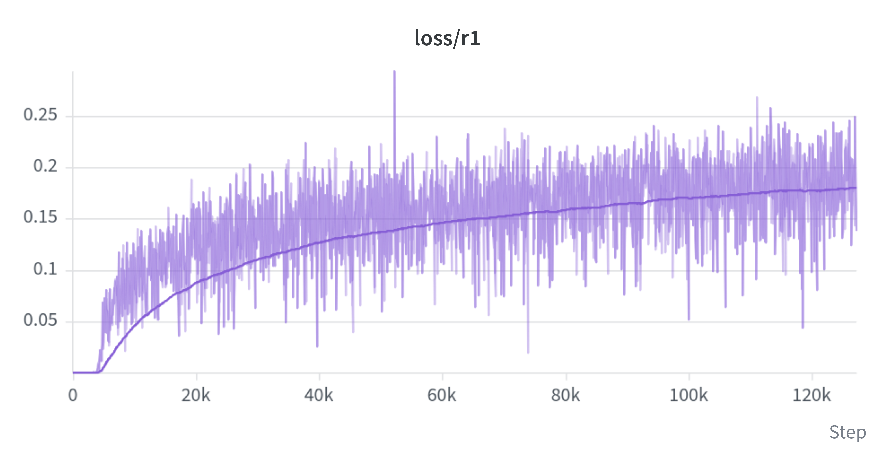

# GAN Image Generation

This project trains a Generative Adversarial Network (GAN) on the [WikiArt](https://www.kaggle.com/datasets/steubk/wikiart) dataset (81,444 paintings) to generate 128x128 paintings from random noise. The implementation is centered around the `GAN` class in [model/GAN.py](model/GAN.py), with generator and discriminator components in [model/generator.py](model/generator.py) and [model/discriminator.py](model/discriminator.py).

### Samples
Random samples generated from `z ~ N(0, I)` with the generator after 100 epochs:

  

## Model Summary
The generator maps a latent vector `z` of size 128 to an image of shape `(B, 3, 128, 128)` in `[-1, 1]`. A linear layer projects `z` to a `512 x 4 x 4` tensor, and five upsampling blocks bring it to `128 x 128`. Each block uses nearest-neighbor upsampling followed by two 3x3 convolutions with BatchNorm and ReLU (the same block as the HW1 VAE decoder), and the output goes through a Tanh.

The discriminator mirrors the generator. Five downsampling blocks (a 3x3 convolution, then a 4x4 stride-2 convolution, each followed by LeakyReLU(0.2)) bring the image to `512 x 4 x 4`, and a linear layer outputs one raw score per image. It has no BatchNorm or spectral norm. It is kept smooth by an R1 gradient penalty instead.

Training uses the non-saturating GAN loss, written with softplus:

$$
\mathcal{L}_D = \mathbb{E}_x\big[\mathrm{softplus}(-D(x))\big] + \mathbb{E}_z\big[\mathrm{softplus}(D(G(z)))\big] + \frac{\gamma}{2}\, \mathbb{E}_x\big[\lVert \nabla_x D(x) \rVert_2^2\big]
$$

$$
\mathcal{L}_G = \mathbb{E}_z\big[\mathrm{softplus}(-D(G(z)))\big]
$$

The last term of $\mathcal{L}_D$ is the R1 penalty (Mescheder et al., 2018), which penalizes the gradient of D on real images. It uses lazy regularization as in StyleGAN: it is computed only every 4th D step, on half the batch, and scaled by 4 to make up for it. Each training step updates D once and then G once.

| Setting | Value |
|---|---|
| Image size | 3 x 128 x 128, scaled to [-1, 1] |
| Data augmentation | Resize + center crop, random horizontal flip |
| Latent dimension | 128 |
| Parameters | G: 3.4M, D: 7.2M |
| Optimizer / learning rate | Adam (betas = 0.0, 0.99) / 2e-4 for both G and D |
| Batch size | 64 |
| Epochs | 100 (about 127k steps) |
| R1 weight (gamma) / interval | 1.0 / every 4 D steps |
| Precision | bf16 mixed precision |

## Generated Results

### Metrics
FID and Inception Score were computed with PyTorch-Ignite every 5 epochs, on 1,000 generated images and a fixed set of 1,000 real images. FID uses the standard 2048-d InceptionV3 pool features. With only 1,000 samples the values are biased upward and not directly comparable to published results, but they are consistent across this run.

| Epoch | Inception Score (higher is better) | FID (lower is better) |
|---|---|---|
| 0 | 2.39 | 219.48 |
| 25 | 5.18 | 91.12 |
| 50 | 5.39 | 86.09 |
| 75 | 5.46 | 82.97 |
| 95 | 5.57 | **79.83** |
| 99 | 5.57 | 80.46 |

Most of the improvement happens in the first 25 epochs. After that, FID drops slowly and IS stays around 5.2 to 5.6. Training stayed stable for all 100 epochs: the discriminator loss settles around 1.2 instead of collapsing to 0, and there was no visible mode collapse in the samples.

### Training curves

  
  

  
  

  

## Usage
To generate images from a trained model, run the notebook [generate_images.ipynb](generate_images.ipynb) (it saves the grid to `results/generated_images.png`), or load the `generator_state_dict` from a checkpoint in [checkpoints/](checkpoints) into the model from [model/GAN.py](model/GAN.py) and call `gan.sample(num_samples)`, which returns images in `[0, 1]`. Training and evaluation are in [GANs_experiments.ipynb](GANs_experiments.ipynb).

